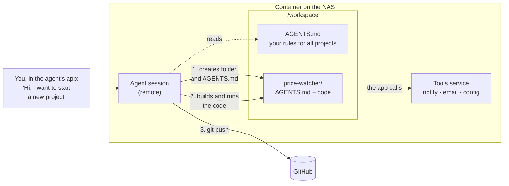
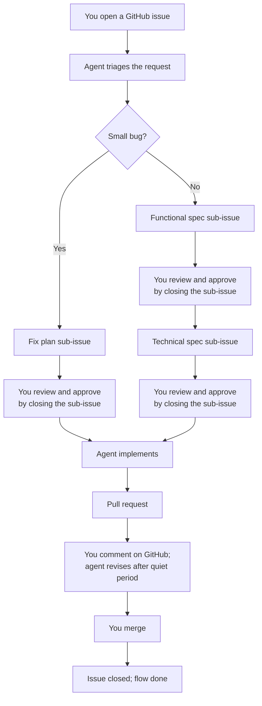

# agent-container

**Your own AI coding agent, running on your own hardware, reachable from your phone.**

Wouldn't it be nice if your coding agent lived in a container on your NAS, working on your
projects around the clock, and you could still pick it up from the Claude app on your phone,
on the couch or on the train?

Wouldn't it be nice to use the agent tool you like today, Claude Code, without locking
yourself in? Your projects, instructions, schedules and tools don't depend on the agent
tool, so when a better one comes along, you swap one part and keep everything else.

And wouldn't it be nice if every app you build came with the boring parts already solved?
Telegram notifications, email, scheduled jobs, logs and central configuration are there from
the start, the same way in every project, so you can focus on the app itself.

That's agent-container.

## What you get

- **Runs where you want it.** One Docker image for amd64 and arm64, so it runs on a Synology,
  a Raspberry Pi or any Linux box. Your code and settings stay on your NAS.
- **Available everywhere.** Sessions show up in claude.ai/code, the Claude mobile app and
  Claude Desktop through Remote Control. No ports to open and no VPN.
- **No SSH, ever.** Logging in, and renewing the login before it expires, happens over
  Telegram: the bot sends a link, you reply with the code.
- **No lock-in.** The instructions (`AGENTS.md`), the tools, scheduling and your projects don't
  depend on the agent tool. Everything tied to Claude Code is listed in one place
  ([Agent tool: Claude Code](#agent-tool-claude-code)), so moving to another tool is a
  contained job.
- **Building blocks for every app.** One local API, also available to agents as MCP tools:
  - Telegram notifications and email
  - cron schedules with logs and failure alerts
  - one central config file
  - a record of which app uses what
- **Repeatable patterns.** Say "Hi, I want to start a new project" and the agent sets it up
  the same way every time: its own folder, its own `AGENTS.md`, Node.js, git, and the shared
  tools.
- **Native spec-driven development, driven entirely from GitHub.** Once enabled for an app,
  take work from issue to reviewed pull request using GitHub issues, comments and approvals—
  no Claude app or agent chat needed to drive the flow. The container runs the configured agent
  in the background; you steer and review the work in GitHub.
- **Built to last.** The tools API never breaks. CI flags any incompatible change, and new
  behaviour arrives as `/v2/`, next to the old version.

The image is built by GitHub Actions and published to `ghcr.io/emilw/agent-container`
(amd64 + arm64) on every push to `main` and weekly.

## Folders

| Container path | Mount | Holds |
| --- | --- | --- |
| `/config` | an empty folder on the NAS | `agent.env` (the central config: container settings and values for your own programs, created on first start from [agent.env.example](agent.env.example)) |
| `/workspace` | your repos folder | the code the agent works on; its `AGENTS.md` holds the main instructions |

The container runs as uid 1000, so both folders must be writable by it. `/config` is
private: anyone with a copy of `config/claude/` can use your Claude account.

## Setup

1. Create a Telegram bot with @BotFather, just for this container, and send it `/start`.
   Get your user ID from @userinfobot.
2. On the NAS, copy `docker-compose.yml`, set the `/workspace` path, then:
   ```bash
   mkdir -p config && sudo chown -R 1000:1000 config
   docker compose up -d
   ```
3. Fill in `TELEGRAM_TOKEN` and `ALLOWED_USER_IDS` in `config/agent.env`, then:
   ```bash
   docker compose restart
   ```
4. The bot sends you a login link. Open it on your phone, sign in with your claude.ai
   account, and reply to the bot with the code the page shows.
5. The first time, the bot asks you to trust `/workspace` (reply `yes`) and forwards
   Remote Control's `Enable Remote Control? (y/n)` question (reply `y`).
6. The bot sends you the session link. Open it, or find **nas** under **Code** in the
   Claude app or at claude.ai/code.

If no link arrives within 30 seconds, the bot sends you Remote Control's screen instead
and types your reply into it.

## Starting a new project

Open the **nas** session in the Claude app and say what you want, for example:

> Hi, I want to start a new project: a script that checks a web shop every morning and
> emails me when the price drops.

The agent agrees on a folder name with you, then creates the project as its own folder in
`/workspace`, your repos folder on the NAS:

```text
/workspace
├── AGENTS.md            your rules for every project (optional)
├── myNewsFeed/
└── price-watcher/       the new project
    ├── AGENTS.md        written first: purpose, how to run it, what it uses
    └── ...              the code, scripts or whatever the project needs
```

The project's `AGENTS.md` is its memory. The agent writes it before anything else and keeps it
current, so a later session, or another agent, picks up where the last one stopped. To come
back, say "let's continue on price-watcher" and the agent reads that file first.

Projects are built in Node.js unless you ask for another language. Inside the folder the agent
can write code, run it, and use the container's tools: Telegram messages, email, scheduled
jobs and values from `agent.env` (see [Tools API](#tools-api)). It also runs `git init`, and
once there's something worth keeping, it can create a private GitHub repo and push (see
[GitHub](#github)).



The agent follows these steps because of the container instructions in [container/AGENTS.md](container/AGENTS.md).
To change how new projects are set up, for example a default language or folder layout,
write your own rules in `/workspace/AGENTS.md`; they take precedence.

## Telegram

The bot sends a new login link, and restarts Remote Control on the new login once you
reply with the code, when:

- there is no login (Remote Control stays stopped until you log in)
- Claude Code warns the login expires in a few days, or says it has expired
  (Remote Control keeps running while it waits for you)
- the health check fails with a login error (every `HEALTH_PING_HOURS`)
- you send `/login`

Commands: `/status`, `/screen` (what Remote Control is showing), `/login`, `/restart`.
Only users in `ALLOWED_USER_IDS` are listened to, and the bot deletes your code message
after using it.

Without Telegram configured, log in with `docker exec -it claude claude auth login`
and watch `docker logs claude`.

## GitHub

The GitHub CLI (`gh`) is installed and `git` uses it for github.com credentials. Log in
one of two ways:

- Ask the agent in a session to log in to GitHub. It shows you a one-time code; approve it
  at github.com/login/device. The login is saved in `config/gh`.
- Or set `GH_TOKEN` in `agent.env` (a fine-grained token limited to specific repos) and restart.

Set `GIT_AUTHOR_NAME`, `GIT_AUTHOR_EMAIL`, `GIT_COMMITTER_NAME` and `GIT_COMMITTER_EMAIL`
in `agent.env` for the name on the agent's commits.

## Tools API

Programs you build in `/workspace` can use a small API on `http://127.0.0.1:7777`
(`$AGENT_TOOLS_URL`), reachable only from inside the container:

- `POST /notify` with `{"text": "...", "title": "..."}` sends you a Telegram message (max 20 a minute)
- `POST /email` with `{"subject", "text", "html", "to"}` sends an email through your SMTP account (max 30 an hour).
  Set the `SMTP_*` and `MAIL_*` keys in `agent.env`. Mail goes to the app's `to`, or to
  `MAIL_TO` when it leaves `to` out. Optionally, `MAIL_ALLOWED_TO` limits who apps can send to.
  Port 587 uses STARTTLS, 465 TLS.
- `GET /config/<KEY>` returns a value from `config/agent.env`; `GET /config` lists the keys
- `/schedules` runs commands on a schedule, and `/logs` serves the logs (see below)
- `/issue-flow` turns the [issue flow](#issue-flow) on and off per app and shows its state

Every key in `agent.env` is served except `TELEGRAM_TOKEN`, `GH_TOKEN` and `SMTP_PASS`. Value changes apply
immediately; the container's own settings still need a restart.

Shell scripts use `agent-tools`: `agent-tools notify "..."`, `agent-tools email ...`,
`agent-tools config KEY`, `agent-tools logs [NAME]`, and any endpoint by its name, e.g.
`agent-tools run_schedule name=news`. `agent-tools api` lists them.
[container/AGENTS.md](container/AGENTS.md) tells the agent how to use all of this.

### Scheduled jobs

Jobs run on a cron schedule in the container's time zone (`TZ` in `agent.env`, default
Europe/Stockholm), using [supercronic](https://github.com/aptible/supercronic). They're kept
in `config/schedules.json`, so they survive restarts and image updates. The agent sets them up
with the MCP tools, or you can call the API yourself:

```bash
agent-tools add_schedule name=mynewsfeed cron="0 7 * * *" command=./run.sh cwd=/workspace/myNewsFeed
agent-tools run_schedule name=mynewsfeed     # run it now, to test
agent-tools list_schedules                   # last run, exit code, duration
agent-tools remove_schedule name=mynewsfeed
```

- **Notifications:** you get a Telegram message when a run fails, with its last output.
  Set `notify=always` or `notify=never` per job.
- **Overlap:** a run is skipped while the previous one is still going.
- **Timeouts:** runs are stopped after `timeoutMinutes` (default 60).
- **Restarts:** a run interrupted by a container restart is marked as interrupted.

### Logs

`config/logs/` holds `agent.log` (logins, Remote Control, the scheduler) and one log per job,
`<job>.log`, each with a start and finish line per run. Logs over 5 MB (agent) or 2 MB (jobs)
are moved to `.log.1`. Read them through the API:

```bash
agent-tools logs                      # list
agent-tools logs mynewsfeed           # last 100 lines of a job's log
agent-tools logs agent --lines 300    # the container's own log
```

The same is `GET /logs` and `GET /logs/<name>?lines=N`, and the MCP tools `list_logs` and
`get_log`, so the agent can troubleshoot a failing job by itself.

`GET /openapi.json` describes every endpoint (OpenAPI 3.1), `GET /` lists them, and
`agent-tools api` prints the list.

### API rules: extend, never break

Apps and agents build on this API, so an endpoint or MCP tool that exists must keep working
exactly as before:

- **Allowed:** new endpoints, new optional inputs, new response fields, new enum values.
- **Not allowed on an existing endpoint:**
  - removing or renaming it, one of its inputs, or a response field
  - changing a type
  - making an optional input required
  - removing an enum value
  - changing what a field means
- **Breaking changes get a new version.** Add the new behaviour as a `/v2/...` entry (e.g.
  `POST /v2/email`, MCP tool `email_v2`) next to the old one, and mark the old one
  `deprecated: "use email_v2 instead"`. Paths without a prefix are v1.
- **Removing an old version:** only once `GET /usage` shows nothing calls it any more.

On every pull request, CI compares the new image's `/openapi.json` with the one served by
the image published from `main`, using [scripts/check-api.mjs](scripts/check-api.mjs). A
breaking change fails the check. If the break is intended, for example to finally remove an
old version, merge anyway.

### Usage: who calls what

Every call through REST or MCP is recorded with its caller, so before deprecating something
you know who depends on it. The caller is identified automatically from the process on the
other end of the localhost connection:
- its project folder in `/workspace`
- its program, e.g. `node app.mjs` or the agent tool
- its scheduled job, if any

Apps can also name themselves with an `X-Agent-Client` header, or with `AGENT_CLIENT` for
`agent-tools`.

```bash
agent-tools get_usage                   # every operation, with callers, counts and last use
agent-tools get_usage operation=email   # one operation
agent-tools logs usage                  # the raw call log
```

Totals are kept in `config/state/usage.json`. Each call is also appended to
`config/logs/usage.log`, which records only the caller's program and first argument, never
its other arguments or the request's contents.

### Adding a feature

Every feature is one entry in the `API` list in [agent.mjs](agent.mjs): its REST route,
inputs and handler, plus an `mcp` block if agents should get it as a tool. The REST
routing, the MCP tool list and `/openapi.json` are generated from that list, so every
MCP tool always has a matching REST endpoint, and `agent-tools <id> key=value` calls it.
Mention the feature in [container/AGENTS.md](container/AGENTS.md).

### MCP for agent sessions

The same tools are an MCP server at `http://127.0.0.1:7777/mcp`, named `agent-tools`, with
a tool for each API feature that has an `mcp` block (`GET /` shows which). It works with any
agent tool that supports MCP over HTTP. The container registers it with the current agent tool
on every start (see [Agent tool: Claude Code](#agent-tool-claude-code)), so every session gets
the tools and their usage instructions, and you can still add your own MCP servers.

## Issue flow

The container includes a **native spec-driven development (SDD) flow** for workspace apps.
After the one-time setup and enablement, you can drive the process end to end from GitHub—
without opening Claude, using an agent chat, or issuing commands elsewhere. Open an issue,
review the generated sub-issues, give feedback in comments, approve steps by closing their
sub-issues, and merge the final pull request. The container's watcher runs the configured agent
in the background and keeps the flow moving. GitHub is your interface; the agent tool is an
implementation detail. See the [spec-driven playbook](container/sdd-flow.md).

To enable the flow for an app, ask the agent or use the issue-flow API once:

> Turn on the issue flow for price-watcher

After it is enabled, your day-to-day participation is entirely in GitHub. The app needs a
GitHub repository as its `origin`. Each new issue you open there goes through these steps,
each one a sub-issue for you to review:

- **Small bug:** a fix plan, then the implementation
- **Everything else:** a functional spec, then a technical spec, then the implementation

The implementation ends with a pull request that closes the issue.



### Your part

| To | Do |
| --- | --- |
| Start | Open an issue. For an issue opened before the flow was on, or by someone without write access, add the `sdd` label. |
| Give feedback | Comment on the sub-issue or the pull request, inline or in a review. The agent revises once you've been quiet for a check interval. |
| Approve a step | Close its sub-issue as **completed** |
| Reject a step | Close its sub-issue as **not planned**, which stops the flow |
| Go back a step | Reopen an earlier spec and comment. Closing it again reworks the same pull request to match. |
| Unblock | Fix or answer what the status comment says, then remove the `sdd: blocked` label |
| Finish | Merge the pull request. The agent never merges. |
| Skip the wait | "Continue on issue #N" in an agent session, or `check_issue_flow` |

A **status comment** at the top of each issue always shows the current step, with a line
like "Writing the technical spec, started 14:05" while an agent works on it. You get a
Telegram message when a step is ready for review or something is blocked. When you merge,
the issue and its sub-issues are closed as completed, and the status comment says "Done".

Only comments and labels from people with write access to the repository count, so on a public
repository strangers can't start or steer anything.

When PR feedback changes the design rather than only the code, the agent also updates the
closed spec with a "Changed during implementation" section, so the specs stay a true record of
what was built. For bigger changes, go back a step instead.

### GitHub Copilot

Comments that mention `@copilot` are always left to Copilot, so the container's agent and
Copilot never act on the same comment. You can also have Copilot do the implementation:

> Turn on the issue flow for price-watcher, with Copilot implementing

The container's agent still triages and writes the specs. Once you approve the plan, the issue
is assigned to Copilot, which opens the pull request. You then give feedback there with
`@copilot` comments, and reopening a spec asks Copilot to rework its pull request. This needs a
Copilot plan with the coding agent enabled for the repository. Turning the flow on says so if
it isn't.

### Cost

Checking costs no tokens. Every `SDD_CHECK_MINUTES` (default 15), plain code in the container
asks GitHub what changed. An unchanged repository gets GitHub's "not modified" answer, which
doesn't count against the rate limit. An agent run only starts when a step is due, and each
run does exactly one step. Two caps protect your plan's usage limits:

- `SDD_MAX_RUNS_PER_DAY`, default 30
- `SDD_MAX_RUNS_PER_ISSUE`, default 10

Reaching either blocks the issue with the reason. Runs log to `sdd-<app>`
(`agent-tools logs sdd-price-watcher`). Implementation runs work in a separate git worktree
under `/workspace/.sdd-worktrees`, so your own checkout of the app is never touched.

GitHub access uses the existing `gh` login (see [GitHub](#github)). The state is kept in
`config/state/sdd/`, and the list of watched apps in `config/sdd.json`. If the state is lost,
it's rebuilt from the issues without starting any runs. `GET /issue-flow`
(`issue_flow_status`) shows every app and issue.

## Agent tool: Claude Code

Everything else in this container is agent-tool neutral: the tools API and MCP server,
scheduling, logs, usage tracking and both `AGENTS.md` files. Only these parts tie it to
Claude Code today, and moving to another agent tool means replacing them:

| Claude Code specific | Where |
| --- | --- |
| Remote Control: sessions in claude.ai/code and the Claude apps, the session link, the y/n prompt | `agent.mjs`, `runRemoteControl` |
| The claude.ai login relayed over Telegram, its renewal, and the health check (`claude -p`) | `agent.mjs`, `loginFlow` and `watchdog` |
| Trusting `/workspace` | `agent.mjs`, `ensureWorkspaceTrusted` |
| Registering the MCP server in Claude's user config | `agent.mjs`, `registerMcpServer` |
| The issue flow's default run command, `claude -p` (`SDD_AGENT_COMMAND` replaces it) | `agent.mjs`, `SDD_DEFAULT_AGENT_COMMAND` |
| Login, settings and history in `config/claude` (`CLAUDE_CONFIG_DIR`) | `Dockerfile` |
| `container/AGENTS.md` installed as `/etc/claude-code/CLAUDE.md` | `Dockerfile` |

Check the MCP registration with:

```bash
docker exec claude claude mcp list
```

## Instructions for agents

There are two instruction files, for two different jobs:

| File | For | In the image |
| --- | --- | --- |
| [container/AGENTS.md](container/AGENTS.md) | The agent *inside* the container: starting projects, the tools, scheduling | Yes, installed where the agent tool loads it for every session. It points to the relevant playbook. |
| [AGENTS.md](AGENTS.md) | Coding agents *maintaining this repository*: layout, rules, testing | No |

## Working on this repository

This repository's issues use the same playbook as the [issue flow](#issue-flow),
[container/sdd-flow.md](container/sdd-flow.md), but by hand, since no container watches this
repository. Tell an agent "work on issue #12", and after each approval "continue on issue
#12". It then:

1. triages the issue: a small bug, or the full path
2. tracks each step as a sub-issue of the reported issue: a functional spec, a technical
   spec and the implementation, or a fix plan and the implementation for a small bug
3. waits for you to close each step's sub-issue as completed before starting the next
4. opens a pull request that closes the issue when you merge it

## Troubleshooting

See what Remote Control is showing (detach with `Ctrl+B` then `D`):

```bash
docker exec -it claude tmux -f /opt/agent/tmux.conf attach -t rc
```

## Updating

```bash
docker compose pull && docker compose up -d
```
