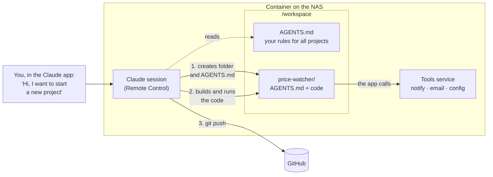

# agent-container

Claude Code running as a Remote Control server, for a NAS. Sessions show up in
claude.ai/code, the Claude mobile app and Claude Desktop. Logging in, and renewing
the login when it expires, happens over Telegram: no SSH needed.

The image is built by GitHub Actions and published to
`ghcr.io/emilw/agent-container` (amd64 + arm64) on every push to `main` and weekly.

## Folders

| Container path | Mount | Holds |
| --- | --- | --- |
| `/config` | an empty folder on the NAS | `agent.env` (the central config: container settings and values for your own programs, created on first start from [agent.env.example](agent.env.example)) and `claude/` (the Claude login, settings and history) |
| `/workspace` | your repos folder | the code Claude works on; its `AGENTS.md` holds the main instructions |

The container runs as uid 1000, so both folders must be writable by it. `/config` is
private: anyone with a copy of `config/claude/` can use your Claude account.

## Setup

1. Create a Telegram bot with @BotFather, just for this container, and send it `/start`.
   Get your user ID from @userinfobot.
2. On the NAS, copy `docker-compose.yml`, set the `/workspace` path, then:
   ```bash
   mkdir -p config && sudo chown -R 1000:1000 config
   docker compose up -d
   ```
3. Fill in `TELEGRAM_TOKEN` and `ALLOWED_USER_IDS` in `config/agent.env`, then:
   ```bash
   docker compose restart
   ```
4. The bot sends you a login link. Open it on your phone, sign in with your claude.ai
   account, and reply to the bot with the code the page shows.
5. The first time, the bot asks you to trust `/workspace` (reply `yes`) and forwards
   Remote Control's `Enable Remote Control? (y/n)` question (reply `y`).
6. The bot sends you the session link. Open it, or find **nas** under **Code** in the
   Claude app or at claude.ai/code.

If no link arrives within 30 seconds, the bot sends you Remote Control's screen instead
and types your reply into it.

## Starting a new project

Open the **nas** session in the Claude app and say what you want, for example:

> Hi, I want to start a new project: a script that checks a web shop every morning and
> emails me when the price drops.

Claude agrees on a folder name with you, then creates the project as its own folder in
`/workspace`, your repos folder on the NAS:

```text
/workspace
├── AGENTS.md            your rules for every project (optional)
├── myNewsFeed/
└── price-watcher/       the new project
    ├── AGENTS.md        written first: purpose, how to run it, what it uses
    └── ...              the code, scripts or whatever the project needs
```

The project's `AGENTS.md` is its memory. Claude writes it before anything else and keeps it
current, so a later session, or another agent, picks up where the last one stopped. To come
back, say "let's continue on price-watcher" and Claude reads that file first.

Inside the folder Claude can write code, run it, and use the container's tools: Telegram
messages, email and values from `agent.env` (see [Tools API](#tools-api)). It also runs
`git init`, and once there's something worth keeping, it can create a private GitHub repo
and push (see [GitHub](#github)).



Claude follows these steps because of the container instructions in [AGENTS.MD](AGENTS.MD).
To change how new projects are set up, for example a default language or folder layout,
write your own rules in `/workspace/AGENTS.md`; they take precedence.

## Telegram

The bot sends a new login link, and restarts Remote Control on the new login once you
reply with the code, when:

- there is no login (Remote Control stays stopped until you log in)
- Claude Code warns the login expires in a few days, or says it has expired
  (Remote Control keeps running while it waits for you)
- the health check fails with a login error (every `HEALTH_PING_HOURS`)
- you send `/login`

Commands: `/status`, `/screen` (what Remote Control is showing), `/login`, `/restart`.
Only users in `ALLOWED_USER_IDS` are listened to, and the bot deletes your code message
after using it.

Without Telegram configured, log in with `docker exec -it claude claude auth login`
and watch `docker logs claude`.

## GitHub

The GitHub CLI (`gh`) is installed and `git` uses it for github.com credentials. Log in
one of two ways:

- Ask Claude in a session to log in to GitHub. It shows you a one-time code; approve it
  at github.com/login/device. The login is saved in `config/gh`.
- Or set `GH_TOKEN` in `agent.env` (a fine-grained token limited to specific repos) and restart.

Set `GIT_AUTHOR_NAME`, `GIT_AUTHOR_EMAIL`, `GIT_COMMITTER_NAME` and `GIT_COMMITTER_EMAIL`
in `agent.env` for the name on Claude's commits.

## Tools API

Programs you build in `/workspace` can use a small API on `http://127.0.0.1:7777`
(`$AGENT_TOOLS_URL`), reachable only from inside the container:

- `POST /notify` with `{"text": "...", "title": "..."}` sends you a Telegram message (max 20 a minute)
- `POST /email` with `{"subject", "text", "html", "to"}` sends an email through your SMTP account (max 30 an hour).
  Set the `SMTP_*` and `MAIL_*` keys in `agent.env`. Mail goes to the app's `to`, or to
  `MAIL_TO` when it leaves `to` out. Optionally, `MAIL_ALLOWED_TO` limits who apps can send to.
  Port 587 uses STARTTLS, 465 TLS.
- `GET /config/<KEY>` returns a value from `config/agent.env`; `GET /config` lists the keys
- `/schedules` runs commands on a schedule, and `/logs` serves the logs (see below)

Every key in `agent.env` is served except `TELEGRAM_TOKEN`, `GH_TOKEN` and `SMTP_PASS`. Value changes apply
immediately; the container's own settings still need a restart.

Shell scripts use `agent-tools`: `agent-tools notify "..."`, `agent-tools email ...`,
`agent-tools config KEY`, `agent-tools logs [NAME]`, and any endpoint by its name, e.g.
`agent-tools run_schedule name=news`. `agent-tools api` lists them.
[AGENTS.MD](AGENTS.MD) tells Claude how to use all of this.

### Scheduled jobs

Jobs run on a cron schedule in the container's time zone (`TZ` in `agent.env`, default
Europe/Stockholm), using [supercronic](https://github.com/aptible/supercronic). They're kept
in `config/schedules.json`, so they survive restarts and image updates. Claude sets them up
with the MCP tools, or you can call the API yourself:

```bash
agent-tools add_schedule name=mynewsfeed cron="0 7 * * *" command=./run.sh cwd=/workspace/myNewsFeed
agent-tools run_schedule name=mynewsfeed     # run it now, to test
agent-tools list_schedules                   # last run, exit code, duration
agent-tools remove_schedule name=mynewsfeed
```

- **Notifications:** you get a Telegram message when a run fails, with its last output.
  Set `notify=always` or `notify=never` per job.
- **Overlap:** a run is skipped while the previous one is still going.
- **Timeouts:** runs are stopped after `timeoutMinutes` (default 60).
- **Restarts:** a run interrupted by a container restart is marked as interrupted.

### Logs

`config/logs/` holds `agent.log` (logins, Remote Control, the scheduler) and one log per job,
`<job>.log`, each with a start and finish line per run. Logs over 5 MB (agent) or 2 MB (jobs)
are moved to `.log.1`. Read them through the API:

```bash
agent-tools logs                      # list
agent-tools logs mynewsfeed           # last 100 lines of a job's log
agent-tools logs agent --lines 300    # the container's own log
```

The same is `GET /logs` and `GET /logs/<name>?lines=N`, and the MCP tools `list_logs` and
`get_log`, so Claude can troubleshoot a failing job by itself.

`GET /openapi.json` describes every endpoint (OpenAPI 3.1), `GET /` lists them, and
`agent-tools api` prints the list.

### API rules: extend, never break

Apps and agents build on this API, so an endpoint or MCP tool that exists must keep working
exactly as before:

- **Allowed:** new endpoints, new optional inputs, new response fields, new enum values.
- **Not allowed on an existing endpoint:**
  - removing or renaming it, one of its inputs, or a response field
  - changing a type
  - making an optional input required
  - removing an enum value
  - changing what a field means
- **Breaking changes get a new version.** Add the new behaviour as a `/v2/...` entry (e.g.
  `POST /v2/email`, MCP tool `email_v2`) next to the old one, and mark the old one
  `deprecated: "use email_v2 instead"`. Paths without a prefix are v1.
- **Removing an old version:** only once `GET /usage` shows nothing calls it any more.

[scripts/check-api.mjs](scripts/check-api.mjs) enforces this. CI starts the image, fetches
`/openapi.json` and compares it with [api/openapi.baseline.json](api/openapi.baseline.json):
any breaking change fails the build before anything is published. After adding endpoints,
record them in the baseline:

```bash
docker build -t agent-container:dev .
docker run -d --name api agent-container:dev && sleep 5
docker exec api curl -s http://127.0.0.1:7777/openapi.json > openapi.json && docker rm -f api
node scripts/check-api.mjs openapi.json --update
```

### Usage: who calls what

Every call through REST or MCP is recorded with its caller, so before deprecating something
you know who depends on it. The caller is identified automatically from the process on the
other end of the localhost connection:
- its project folder in `/workspace`
- its program, e.g. `node app.mjs` or `claude`
- its scheduled job, if any

Apps can also name themselves with an `X-Agent-Client` header, or with `AGENT_CLIENT` for
`agent-tools`.

```bash
agent-tools get_usage                   # every operation, with callers, counts and last use
agent-tools get_usage operation=email   # one operation
agent-tools logs usage                  # the raw call log
```

Totals are kept in `config/state/usage.json`. Each call is also appended to
`config/logs/usage.log`, which records only the caller's program and first argument, never
its other arguments or the request's contents.

### Adding a feature

Every feature is one entry in the `API` list in [agent.mjs](agent.mjs): its REST route,
inputs and handler, plus an `mcp` block if Claude should get it as a tool. The REST
routing, the MCP tool list and `/openapi.json` are generated from that list, so every
MCP tool always has a matching REST endpoint, and `agent-tools <id> key=value` calls it.
Mention the feature in [AGENTS.MD](AGENTS.MD), and update the API baseline (see above).

### MCP for Claude sessions

The same tools are an MCP server at `http://127.0.0.1:7777/mcp`, named `agent-tools`,
with the tools `notify`, `email`, `get_config` and `list_config`. The container registers it in
Claude's user config (`config/claude/.claude.json`) on every start, so all sessions get
it and its usage instructions automatically, and you can still add your own MCP servers.
Check it with:

```bash
docker exec claude claude mcp list
```

## Instructions for Claude

[AGENTS.MD](AGENTS.MD) is installed as `/etc/claude-code/CLAUDE.md`, so every
session in the container loads it. It points Claude at `/workspace/AGENTS.md`.

## Troubleshooting

See what Remote Control is showing (detach with `Ctrl+B` then `D`):

```bash
docker exec -it claude tmux -f /opt/agent/tmux.conf attach -t rc
```

## Updating

```bash
docker compose pull && docker compose up -d
```
